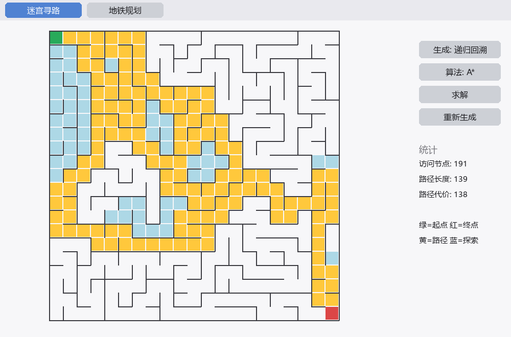
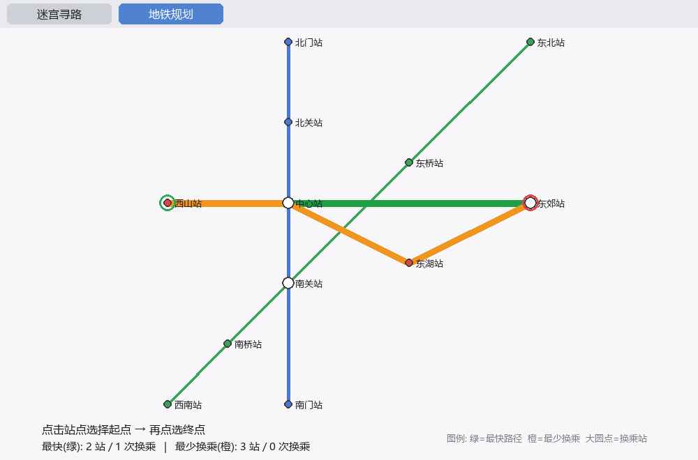

# PathPlanner — 图最短路径可视化与规划系统

一个 Python 图形化程序，用**同一套图搜索内核**支撑两个场景：
- **迷宫寻路**：生成迷宫 + BFS/DFS/Dijkstra/A* 求解动画 + 算法效率对比
- **地铁规划**：最短路径与最少换乘双目标规划

## 项目背景与目标

**面向谁、解决什么问题？** 面向学习「数据结构与算法」的同学。图搜索（BFS/Dijkstra/A*）是课程核心，但"算法如何在图上逐步扩展"以及"边权设计如何影响结果"往往难以直观理解。本项目的迷宫模块可视化搜索过程，地铁模块用真实换乘问题展示边权建模的价值。

**已完成功能：**
- 迷宫：递归回溯 / 随机 Prim 两种生成 + BFS/DFS/Dijkstra/A* 求解动画 + 访问节点/路径统计
- 地铁：加载线路数据、点击选起终点、最快路径（站数最少）与最少换乘（换乘惩罚）双结果对比
- 两个模块共享 `graph.py` 搜索内核

## 课程知识与核心设计

### 1. 数据结构与算法选型
| 算法 | 数据结构 | 适用场景 |
| :--- | :--- | :--- |
| BFS | 队列 | 无权图最短路径（迷宫对照基准） |
| DFS | 栈 | 展示搜索顺序差异（不保证最短） |
| Dijkstra | 优先队列（最小堆） | 加权图最短路径（地铁） |
| A* | 优先队列 + 启发式 | 加权 + 剪枝（迷宫用曼哈顿距离） |

### 2. 图建模与边权设计（地铁）
- **线路分层建模**：节点 = (站, 线路)，同一站不同线路为不同节点。
- 运行边权 1（一站）；换乘边权 = 换乘惩罚。
- **双目标**：最快路径（惩罚 0）→ 站数最少；最少换乘（惩罚 10）→ 优先减少换乘。
- 这直观展示了「同一张图，不同边权 → 不同最优解」的建模思想。

### 3. 复杂度分析
- BFS / DFS：`O(V+E)` 时间、`O(V)` 空间。
- Dijkstra / A*：`O((V+E) log V)`（二叉堆）。
- 迷宫为稀疏网格图（21×21，V=441）；地铁为小图（V≈14）。
- **有趣结论**：完美迷宫是树，任意两点路径唯一，故 DFS 在迷宫中恰好也返回最短路径（访问节点甚至更少）；但在一般图上 DFS 不保证最短。

## 安装与运行

- 环境：Python 3.10+；依赖 `pygame`（`pip install pygame`）。

```bash
pip install -r requirements.txt

python src/app.py          # 图形界面
python src/benchmark.py    # 算法/双目标对比
python -m pytest tests -q  # 测试
```

## 功能展示

### 迷宫寻路
绿色起点、红色终点、蓝色已探索、黄色最短路径，右侧为实时统计：



### 地铁规划
绿色=最快路径（2 站 1 换乘，走捷径线），橙色=最少换乘（3 站 0 换乘），直观对比边权设计效果：



算法对比示例（`benchmark.py`，21×21 迷宫）：
```
算法       路径长度   访问节点   frontier峰值   耗时(ms)
bfs           255        424          6        0.91
dfs           255        269         18        0.66
dijkstra      255        424          6        1.02
astar         255        408          7        1.04
```

## 测试与结果

- 17 个测试全部通过：`17 passed`。
- 覆盖：BFS/Dijkstra/A* 正确性与最短性、迷宫连通性与完美迷宫性质、地铁最快/最少换乘/不可达边界。

## 局限与改进

- 地铁数据为手写小规模样例（4 线 14 站），可替换为真实城市数据。
- 迷宫固定 21×21，未做尺寸选择。
- 换乘惩罚为固定值，未做成可调参数。

## 来源与 AI 使用声明

- 算法（BFS/Dijkstra/A*、迷宫生成、线路分层建模）为公开经典方法，自行实现，无第三方代码复用。

```text
使用工具：WorkBuddy（AI 智能体）
参与环节：需求梳理、代码生成与调试、测试编写、README 草拟
本人完成的设计、修改与判断：根据课程设计的需求进行项目的选择，针对图，搜索路径进行更深入的了解；用到的算法方式主要涉及数据结构中的算法，适当向外进行扩充。
验证方法及结果：pytest 17 项通过；benchmark 实测对比
代表性协作案例或记录位置：无
引用与复用的外部资源：无
```

## 目录结构

```
PathPlanner/
├── src/
│   ├── graph.py        # 通用图 + BFS/DFS/Dijkstra/A*
│   ├── maze.py         # 迷宫生成（回溯/Prim）+ 网格转图
│   ├── metro.py        # 地铁线路分层建模 + 双目标
│   ├── app.py          # Pygame 界面（双模式）
│   ├── benchmark.py    # 算法对比
│   └── data/metro.json # 地铁样例数据
├── tests/              # pytest 测试
├── docs/               # 结果文档（课程提交 PDF 主文档的原始 .md）
├── examples/           # 截图与演示
├── .gitignore          # 忽略虚拟环境/缓存/IDE 配置
├── README.md
├── requirements.txt
└── LICENSE
```
