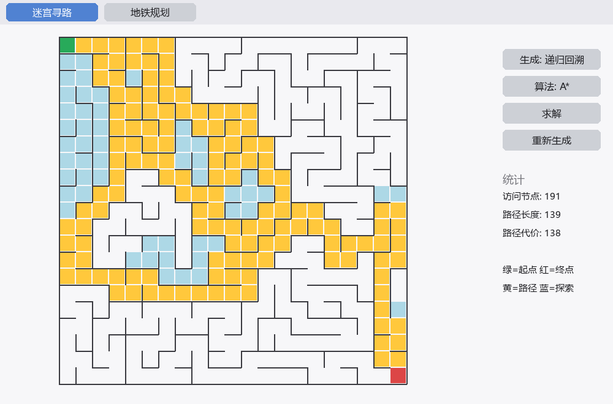
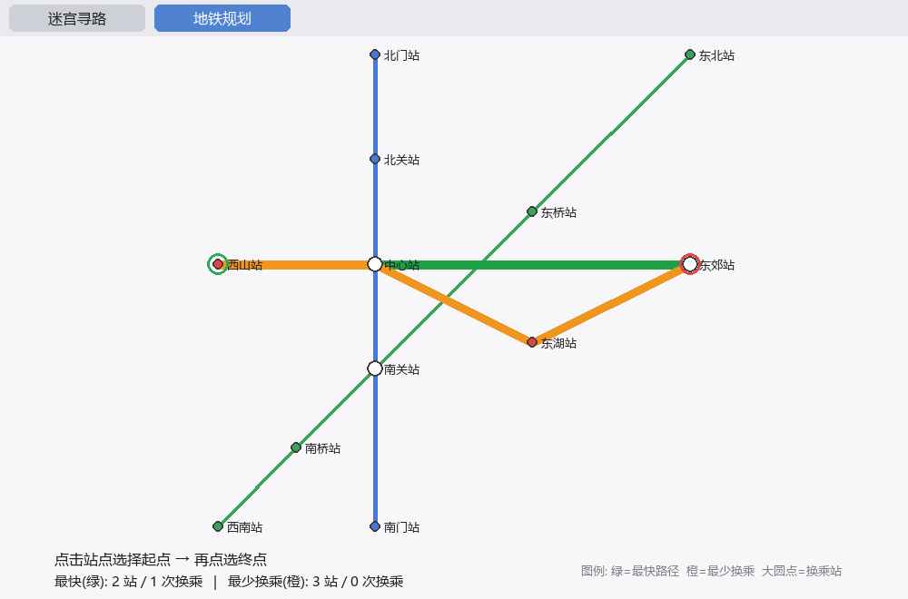

# 数据结构与算法课程设计结果文档

## PathPlanner — 图最短路径可视化与规划系统

| 项目信息 | 内容 |
| :--: | :--: |
| **姓名** | 郭韩帅 |
| **院系 / 专业** | 重庆人工智能学院 |
| **项目名称** | PathPlanner — 图最短路径可视化与规划系统 |
| **GitHub 仓库** | https://github.com/BeiZhi-Ghs/PathPlanner |
| **最终提交版本** | v1.0（Initial commit） |
| **在线演示** | 无（本地运行，见安装与运行） |

---

## 一、项目概述

PathPlanner 是一个 Python 图形化程序，用**同一套图搜索内核**支撑两个应用场景：

- **迷宫寻路**：生成迷宫 + BFS/DFS/Dijkstra/A\* 求解动画 + 算法效率对比；
- **地铁规划**：最短路径与最少换乘双目标规划。

**核心思路**：两个场景本质上都是「图 + 最短路径搜索」。项目将搜索算法抽象为统一内核 `graph.py`，迷宫模块（网格图）与地铁模块（加权图）共用同一套 `search()` 接口，既保证代码复用，也直观展示了「同一算法、不同图模型、不同边权 → 不同最优解」的设计思想。

---

## 二、项目核心截图

**迷宫寻路**（绿色=起点，红色=终点，蓝色=已探索，黄色=最短路径，右侧为实时统计）：



**地铁规划**（绿色=最快路径「2 站 1 换乘」，橙色=最少换乘「3 站 0 换乘」，两条路线不同，直观对比边权设计效果）：



---

## 三、项目背景与目标

**面向谁、解决什么问题？** 面向学习「数据结构与算法」的同学。图搜索（BFS / Dijkstra / A\*）是课程核心内容，但「算法如何在图上逐步扩展」「边权设计如何影响结果」往往难以直观理解。本项目的迷宫模块可视化搜索的逐步推进过程，地铁模块用真实的换乘问题展示边权建模的价值。

**已完成的核心功能：**

1. 迷宫生成：递归回溯（栈）+ 随机化 Prim（优先队列）两种算法；
2. 迷宫求解：BFS / DFS / Dijkstra / A\* 四种算法，含逐步动画与访问节点数、路径长度、frontier 峰值统计；
3. 地铁规划：加载线路数据、点击选起终点、输出最快路径（站数最少）与最少换乘（换乘惩罚）双结果对比；
4. 两个模块共享 `graph.py` 搜索内核。

**功能完成判定标准**：能对任意可解迷宫返回连通路径且与理论最短一致；能对指定地铁起终点同时给出两种目标下的最优路径；全部测试通过。

---

## 四、课程知识与核心设计

### 4.1 数据结构与算法选型

| 算法 | 使用的数据结构 | 适用场景 |
| :--- | :--- | :--- |
| BFS | 队列 | 无权图最短路径（迷宫对照基准） |
| DFS | 栈 | 展示搜索顺序差异（不保证最短） |
| Dijkstra | 优先队列（最小堆） | 加权图最短路径（地铁） |
| A\* | 优先队列 + 启发式 | 加权 + 剪枝（迷宫用曼哈顿距离） |

### 4.2 图建模与边权设计（地铁模块）

- **线路分层建模**：节点 =（站点, 线路），同一站的不同线路视为不同节点；
- 运行边权设为 1（乘坐一站）；换乘边权 = 换乘惩罚；
- **双目标**：最快路径（换乘惩罚 0）→ 站数最少；最少换乘（换乘惩罚 10）→ 优先减少换乘；
- 直观展示了「同一张图，不同边权 → 不同最优解」的建模思想。

### 4.3 复杂度分析

- BFS / DFS：时间 `O(V+E)`、空间 `O(V)`；
- Dijkstra / A\*：时间 `O((V+E) log V)`（二叉堆）；
- 迷宫为稀疏网格图（21×21，V=441）；地铁为小规模样例图（4 线 14 站）。

**一个有价值的结论**：完美迷宫是一棵树，任意两点间路径唯一，因此 DFS 在迷宫中恰好也能返回最短路径（访问节点甚至更少）；但在一般图上 DFS 不保证最短。这一现象在 benchmark 中得到了实测印证。

---

## 五、安装与运行

- **环境**：Python 3.10+；
- **依赖**：`pygame`（`pip install pygame`）。

```bash
pip install -r requirements.txt

python src/app.py          # 图形界面
python src/benchmark.py    # 算法 / 双目标对比
python -m pytest tests -q  # 测试
```

---

## 六、功能展示与算法对比

算法对比示例（`benchmark.py`，21×21 迷宫）：

```text
算法       路径长度   访问节点   frontier峰值   耗时(ms)
bfs           255        424          6        0.91
dfs           255        269         18        0.66
dijkstra      255        424          6        1.02
astar         255        408          7        1.04
```

地铁双目标示例（西山站 → 东郊站）：最快路径 2 站 1 换乘（走 4 号线捷径），最少换乘 3 站 0 换乘，两条路线不同，见上文截图。

---

## 七、测试与结果

- 测试框架：`pytest`；
- 结果：`17 passed`，全部通过；
- 覆盖范围：BFS / Dijkstra / A\* 的正确性与最短性、迷宫连通性与完美迷宫性质、地铁最快路径 / 最少换乘 / 不可达边界情况。

---

## 八、局限与改进

- 地铁数据为手写小规模样例（4 线 14 站），可替换为真实城市数据；
- 迷宫固定 21×21，尚未提供尺寸选择；
- 换乘惩罚为固定值，尚未做成可调参数。

---

## 九、来源与 AI 使用声明

- 算法（BFS / Dijkstra / A\*、迷宫生成、线路分层建模）均为公开经典方法，自行实现，无第三方代码复用。

```text
使用工具：WorkBuddy（AI 智能体）
参与环节：需求梳理、方案比较、代码生成与调试、测试编写、文档草拟
本人完成的设计、修改与判断：根据课程设计的需求进行项目的选择，针对图、搜索路径进行更深入的了解；用到的算法方式主要涉及数据结构中的算法，适当向外进行扩充。
验证方法及结果：pytest 17 项通过；benchmark 实测算法对比；GUI 截图人工核验
代表性协作案例或记录位置：无
引用与复用的外部资源：无
```

---

## 十、目录结构

```text
PathPlanner/
├── src/
│   ├── graph.py        # 通用图 + BFS/DFS/Dijkstra/A*
│   ├── maze.py         # 迷宫生成（回溯/Prim）+ 网格转图
│   ├── metro.py        # 地铁线路分层建模 + 双目标
│   ├── app.py          # Pygame 界面（双模式）
│   ├── benchmark.py    # 算法对比
│   └── data/metro.json # 地铁样例数据
├── tests/              # pytest 测试
├── docs/               # 本文档（结果文档）
├── examples/           # 截图与演示
├── .gitignore          # 忽略虚拟环境/缓存/IDE 配置
├── README.md
├── requirements.txt
└── LICENSE
```
